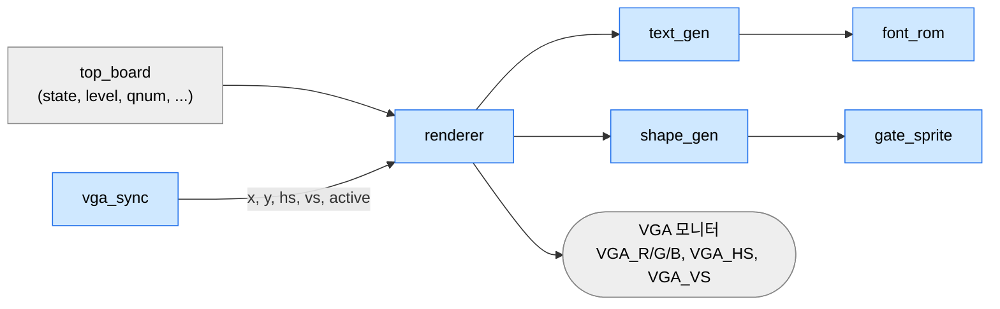

# Karnaugh Gate Quiz (Nexys4 DDR, Verilog)

카르노 맵(K-map)을 보고 숨겨진 논리 게이트를 맞히는 퀴즈(레벨 1)와, MUX 선택 신호를 조절해 목표 숫자를 출력시키는 퀴즈(레벨 2)를 FPGA(Nexys4 DDR)에서 VGA 화면으로 즐기는 게임입니다.

- 클럭은 100MHz 하나만 사용합니다. 느린 동작(25MHz 픽셀, 7세그 스캔)은 별도 클럭이 아니라 **enable 펄스**로 만듭니다.
- 수업 실습 코드(Lab 2 Mux, Lab 4 레지스터, Lab 5 Moore FSM, Lab 10 `Button`/`Display4`/`Register4`/`Register4_top`)를 기반으로 만들었습니다 (5절 참고). 리셋은 수업 코드처럼 **active-low**(`if(!rst)`)이고 모든 모듈에 `rst` 핀이 그대로 들어갑니다.
- 프레임 버퍼가 없습니다. VGA 좌표 `(x,y)`가 들어올 때마다 그 위치의 **문자와 도형을 조합 논리로 계산**해서 색을 내보냅니다.
- 문제는 5개로 고정이며 ROM(`puzzle_rom.v`)에 들어 있습니다. 랜덤 생성은 없습니다.

---

## 1. 게임 규칙

총 5문제, 목숨 3개입니다. 화면의 안내에 따라 풀고 **중앙 버튼(BTNC)** 으로 제출/다음 화면으로 넘어갑니다.

| 문제 | 레벨 | 유형 | 정답 |
|---|---|---|---|
| Q1 | 1 | 숨겨진 게이트 맞히기 | AND |
| Q2 | 1 | 〃 | NOR (OR + NOT) |
| Q3 | 1 | 〃 | XOR |
| Q4 | 2 | 8:1 MUX 하나 | 입력 D0~D7 = `3 8 5 1 7 2 9 4`, 목표 **9** → `ABC = 110` (D6) |
| Q5 | 2 | 4:1 MUX 두 개 + 2:1 MUX 하나 | 위 MUX D0~D3 = `6 2 8 5`, 아래 MUX E0~E3 = `1 4 7 3`, 목표 **4** → `ABC = 011` (E1) |

### 레벨 1 (Q1~Q3) : 게이트 맞히기

화면 오른쪽에 숨겨진 게이트 `F = G(A,B)`의 **2x2 K-map**이 나옵니다 (행 = A, 열 = B, 칸 안의 0/1 = F). 플레이어는 K-map의 0/1 패턴을 보고 게이트를 고릅니다.

| 입력 | 동작 |
|---|---|
| `BTNU` | AND 선택 |
| `BTNL` | OR 선택 |
| `BTNR` | XOR 선택 |
| `SW0` 올림 | NOT (출력 반전): AND+NOT = NAND, OR+NOT = NOR, XOR+NOT = XNOR |
| `BTNC` | 제출 (게이트를 하나도 고르지 않았으면 무시됨) |

- 고른 게이트의 기호(AND/OR/XOR + NOT 버블)와 이름이 왼쪽에 바로 그려지고, `SW0`을 움직이면 즉시 반영됩니다.
- 정답이면 숨겨진 게이트가 초록색으로 표시되고(`THE GATE`), 오답이면 `YOUR GATE GIVES A DIFFERENT K-MAP`이 나옵니다.
- 오답 후 다시 시도할 때는 이전에 고른 게이트가 그대로 남아 있습니다.

### 레벨 2 (Q4~Q5) : MUX 선택 신호 맞히기

선택 신호 **A, B, C**를 스위치로 정해 MUX 출력이 목표 숫자가 되게 합니다.

| 스위치 | 의미 |
|---|---|
| `SW3` | A |
| `SW2` | B |
| `SW1` | C |

제출 / 다음 화면은 레벨 1과 같이 `BTNC`로 합니다.

- **Q4 (8:1 MUX)**: 입력 번호 = `{A,B,C}` (A가 최상위 비트). 예) `ABC=110` → D6.
- **Q5 (4:1 MUX ×2 + 2:1 MUX)**: A, B가 두 4:1 MUX의 **공통 선택 신호**이고, C가 마지막 2:1 MUX의 선택 신호입니다. 출력 = `C ? 아래MUX[AB] : 위MUX[AB]`.
- 풀이 중에는 현재 `ABC` 값만 표시되고 출력은 `OUT = ?`로 가려져 있습니다. 제출 후 결과 화면에서 선택된 입력(초록)과 신호 경로(노랑), 실제 출력값이 공개됩니다.

### 점수와 목숨

| 상황 | 점수 |
|---|---|
| 레벨 1, 그 문제에서 오답 없이 정답 | 100점 |
| 레벨 1, 한 번 틀린 뒤 정답 | 70점 |
| 레벨 1, 두 번 이상 틀린 뒤 정답 | 40점 |
| 레벨 2 정답 | 항상 100점 |

- 오답이면 목숨이 1 줄어듭니다 (레벨 1, 2 공통). 목숨이 0이 되면 `GAME OVER`.
- 5문제를 모두 풀면 `STAGE CLEAR!`. 최고점(`HIGH SCORE`)은 게임을 다시 시작해도 유지되고, 리셋하면 0이 됩니다.
- 만점은 500점입니다.

### 보드 입출력

| 장치 | 내용 |
|---|---|
| 리셋 | `CPU_RESETN` (누르면 0) |
| VGA | 640x480 @ 60Hz, RGB 각 4비트 |
| 7세그 | `AN2~AN0`에 현재 점수(3자리). 나머지 자리는 꺼짐 |
| LED | `led_x[2:0]`=남은 목숨 (3개면 모두 켜짐, 목숨은 7세그에 나오지 않음), `led_x[3]`, `led_y`(RGB LED)는 사용 안 함 |

---

## 2. 게임 흐름 (`control_fsm.v`)

상태는 `state = 0 ~ 5` 여섯 개입니다.

| state | 이름 | 화면 | 다음 상태 |
|---|---|---|---|
| 0 | `TITLE` | 제목, 최고점 | `go` → `INIT` |
| 1 | `INIT` | (1클럭만 머무름, 플레이어 답 초기화) | 바로 `ANSWER` |
| 2 | `ANSWER` | 문제 풀이 | `go` & `ans_ok` → 일치하면 `CORRECT`, 아니면 `WRONG` |
| 3 | `CORRECT` | 정답 결과, 획득 점수 | `go` → 마지막 문제면 `END`, 아니면 `INIT` (다음 문제) |
| 4 | `WRONG` | 오답 결과 | `go` → 목숨 0이면 `END`, 아니면 `ANSWER` (재시도) |
| 5 | `END` | `STAGE CLEAR!` / `GAME OVER`, 최종 점수 | `go` → `TITLE` |

```
TITLE(0) → INIT(1) → ANSWER(2) ─┬ 일치 → CORRECT(3) ─┬ 마지막 문제 → END(5) → TITLE(0)
                       ▲        │                     └ 아니면 ────→ INIT(1)
                       │        └ 불일치 → WRONG(4) ─┬ 목숨 0 ────→ END(5)
                       └─────────────────────────────┘ 목숨 남음 → ANSWER(2)
```

- `go`는 중앙 버튼(`BTNC`)의 1클럭 펄스입니다. 모든 상태 전이는 이 하나로 일어납니다.
- `ans_ok`: 레벨 1은 게이트를 하나라도 골랐을 때만 1, 레벨 2는 항상 1.
- `match`: 레벨 1은 `정답 게이트 코드 == 플레이어 게이트 코드`, 레벨 2는 `MUX 출력 == 목표 숫자`.
- 점수·목숨처럼 **딱 한 번만** 바뀌어야 하는 동작은 상태에 들어온 첫 클럭에만 1이 되는 `entering` 플래그로 만듭니다 (`score_add`, `life_dec`, `upd_best`).
- `INIT`에서 플레이어 답이 지워지고(`clr_round`), `TITLE`에서 점수·목숨·문제 번호가 초기화됩니다(`game_clr`).
- 상태 번호는 `control_fsm`, `text_gen`, `shape_gen`이 각자 `localparam`으로 같은 값(0~5)을 쓰고, `top_board`도 `CORRECT`(3), `ANSWER`(2)를 숫자로 직접 비교합니다.

---

## 3. 데이터 흐름과 모듈 연결

```
버튼 ─ Button ─ bc,bu,bl,br,s4 ─┐        SW0~SW3은 top에서 직접 사용
                                ▼
                 ┌──────── control_fsm ⇄ score_unit (qnum, level, lives, score, best, pts)
                 │ state, game_clr, clr_round, ans_edit, score_add, life_dec, upd_best, q_adv
                 │
 qnum ─ puzzle_rom ─┬ h_g1 (정답 게이트) ─┬─ kmap_val ─→ hid_val (K-map 표시)
                    │                     └─ (h_g1 == a_g1) ─┐
                    │    answer_reg ─→ a_g1 ────────────────┘   match
                    └ d0..d3, e0..e3, tgt ─ MUX 선택 로직 ─→ mux_out ─ (mux_out == tgt) ─ match

 score/best/pts ─ bin2bcd ─ Display3 ─→ 7세그
 vga_sync ─ renderer ─┬ text_gen ─ font_rom
                      └ shape_gen ─ gate_sprite          ─→ VGA
```

### 모듈 설명

🟦 = 모니터(VGA) 출력과 관련된 모듈

| 파일 | 역할 |
|---|---|
| `top_board.v` | 최상위(수업의 `Register4_top`에 해당). 모든 모듈을 연결하고, 레벨 2의 MUX 계산(`mux_up/low/8/out`), 정답 판정(`match`, `ans_ok`), 7세그·LED 배치를 담당 |
| `Button.v` | 수업 `Button.v` 기반. FF 3단(`btn1→btn2→btn3`)으로 동기화하고 `pls = btn2 & !btn3`로 눌림 순간 1클럭 펄스. 실제 보드의 버튼 떨림 때문에 에지 후 10ms(`LOCK`) 동안 추가 펄스를 막는 잠금 카운터를 더함 |
| `control_fsm.v` | 게임 흐름 Moore FSM (2절 참고). 수업 `MooreStateM.v`와 같은 틀(`preState`/`nextState`, 순차 블록 + 조합 블록 `case`) |
| `Mux.v`, `Mux4to1.v`, `Mux8to1.v` | 수업 Lab 2의 2:1, 4:1 MUX(조건 연산자)와 연습문제의 8:1 MUX(4:1 두 개 + 2:1 하나). 레벨 2의 MUX 동작을 이 모듈들로 구성 |
| `score_unit.v` | 문제 번호 `qnum`(0~4), 레벨(`qnum<3`이면 1, 아니면 2), 목숨, 점수, 최고점, 문제별 오답 횟수 `wrongs`(최대 3)와 획득 점수 `pts` |
| `puzzle_rom.v` | `qnum`으로 고르는 고정 문제표. 레벨 1은 정답 게이트 코드 `g1`, 레벨 2는 MUX 입력 `d0~d3`, `e0~e3`과 목표 `tgt` |
| `answer_reg.v` | 레벨 1에서 플레이어가 고른 기본 게이트(AND/OR/XOR)를 래치하고, `SW0`(NOT)은 실시간으로 반영해 `a_g1 = {NOT, base}` 출력. 아직 고르지 않았으면 `111` |
| `gate_unit.v` | 3비트 코드로 종류가 정해지는 2입력 게이트 (아래 표) |
| `kmap_val.v` | 게이트 하나의 2x2 진리표 `val[{A,B}] = gate(A,B)`. 화면의 K-map을 그리는 데 사용 |
| 🟦 `vga_sync.v` | 25MHz 픽셀 enable(`pix_en`) 생성, 800x525 타이밍, 좌표 `x,y`, `hs/vs/active` |
| 🟦 `renderer.v` | text > shape > background 우선순위로 합성하는 3단 파이프라인 (4절 참고) |
| 🟦 `text_gen.v` | 80열x30행 문자 격자에서 `(col,row)`마다 ASCII 문자와 색 속성을 결정 (모든 화면 문구가 여기에 있음) |
| 🟦 `shape_gen.v` | 도형 레이어: 게이트 기호·입력선·NOT 버블·K-map 칸(레벨 1), MUX 사다리꼴·배선·선택 경로 강조(레벨 2), 정답/오답 테두리, 제목·종료 화면 장식 상자 |
| 🟦 `gate_sprite.v` | AND/OR/XOR 외곽선 비트맵(32x40) — `gen_sprite.py`로 생성 |
| 🟦 `font_rom.v` | 8x16 폰트 — `gen_font.py`로 생성 (`text_gen.v`에 나오는 글자만 포함) |
| `Display3.v` | 수업 `Display4.v`를 3자리(`AN2~AN0`)로 확장. 14비트 카운터(10000클럭)로 자릿수 선택(`digit`, one-cold)을 순환시키고, 선택된 자리의 값(`dec`)을 active-low 패턴(`seg`)으로 변환. 점수만 표시하고 `AN7~AN3`은 항상 꺼짐 |
| `bin2bcd.v` | Double-Dabble 방식 10비트 이진수 → 3자리 BCD (점수, 최고점, 문제 점수 표시용) |

### 게이트 코드 (`gate_unit`)

| 코드 | 게이트 | | 코드 | 게이트 |
|---|---|---|---|---|
| `000` | AND | | `100` | NAND |
| `001` | OR | | `101` | NOR |
| `010` | XOR | | `110` | XNOR |

`code[2]`가 출력 반전, `code[1:0]`이 기본 게이트(00 AND, 01 OR, 10 XOR)입니다. 6가지 코드는 진리표가 모두 달라서, 정답 판정은 K-map을 비교하지 않고 **코드 비교(`h_g1 == a_g1`)** 로 합니다.

---

## 4. 화면 출력 (VGA)

### 모니터(VGA) 관련 모듈

파란색 노드가 모니터 출력과 관련된 모듈입니다.



### 타이밍
- 640x480 @ 60Hz. 가로 800 = 640(표시) + 16 + 96(HS) + 48, 세로 525 = 480(표시) + 10 + 2(VS) + 33. HS, VS는 active-low.
- 100MHz 클럭을 4분주한 25MHz enable(`pix_en`)마다 픽셀 좌표가 1씩 증가합니다.

### 레이어 구성
화면은 세 겹으로 만들어집니다.

1. **배경/도형 (`shape_gen`)**: 좌표 `(x,y)` → 12비트 RGB. 게이트 기호, K-map 칸, MUX 도형, 배선, 테두리 등.
2. **문자 (`text_gen`)**: 8x16 픽셀 문자 셀 단위(`col = x[9:3]`, `row = y[8:4]`)로 ASCII 코드와 색 속성(흰색/노랑/초록/빨강/하늘색/회색)을 결정.
3. **합성 (`renderer`)**: 문자 픽셀이 켜져 있으면 문자 색, 아니면 도형 색. 표시 영역 밖은 검정.

### `renderer`의 3단 파이프라인
`font_rom`이 한 단계의 읽기 지연을 가지므로 신호를 단계별로 맞춥니다. 모든 단계는 `pix_en`마다 한 칸씩 전진합니다.

| 단계 | 하는 일 |
|---|---|
| stage 1 | `text_gen`/`shape_gen` 결과(문자 코드, 색 속성, 도형 색, 셀 안 위치)와 HS/VS/active를 저장 |
| stage 2 | `font_rom`에서 해당 행의 8픽셀을 읽어 저장 |
| stage 3 | 문자 픽셀 여부로 색을 고르고 출력 레지스터에 저장 |

HS, VS, active도 같은 3단을 통과하므로 문자가 밀리지 않습니다.

### 화면별 내용
- **TITLE**: 제목, 규칙 한 줄 설명, `PRESS CENTER BUTTON TO START`, `HIGH SCORE`
- **레벨 1 문제 화면**: 상단 정보줄(`LEVEL`, `Q n/5`, `LIVES`, `SCORE`, `BEST`), 게이트 기호와 이름, `KARNAUGH MAP OF F`(2x2), 조작 안내
- **레벨 2 문제 화면**: 목표(`GOAL`), 입력 값(D0~D7 또는 D0~D3/E0~E3), MUX 도형과 배선, 현재 `ABC` 값, `OUT`
- **CORRECT / WRONG**: 획득 점수 또는 안내 문구, 테두리 색(정답 초록, 오답 빨강)
- **END**: `STAGE CLEAR!` 또는 `GAME OVER`, `FINAL SCORE`, `HIGH SCORE`

---

## 5. 수업 코드(Lab 10)와의 대응

| 수업 코드 | 이 프로젝트 | 같은 점 / 바뀐 점 |
|---|---|---|
| `Button.v` | `Button.v` | 3단 FF + `pls = btn2 & !btn3` 구조 그대로. 버튼 떨림 방지용 잠금 카운터(`LOCK`) 추가 |
| `Display4.v` | `Display3.v` | 클럭 분주 카운터, one-cold `digit`, `dec` 선택, 7세그 패턴 `case` 구조 그대로. 2자리 → 3자리, 파생 클럭 대신 enable(`tick`) 사용 |
| (Double-Dabble `s1~s4`) | `bin2bcd.v` | 같은 shift-and-add-3 알고리즘. 점수가 최대 500이라 10비트로 확장해 반복문으로 작성 |
| Lab 2 `Mux`, `Mux4to1`, `Mux8to1` | `Mux.v`, `Mux4to1.v`, `Mux8to1.v` | 수업 코드 그대로 사용. `top_board.v`가 레벨 2에서 인스턴스로 연결 (Q5: 4:1 두 개 + 2:1, Q4: 8:1) |
| Lab 5 `MooreStateM.v` | `control_fsm.v` | `preState`/`nextState`, 동기 리셋 순차 블록, `case (preState)` 조합 블록(다음 상태 + Moore 출력) 구조 그대로. 상태가 6개이고 `OC` 출력 버퍼는 사용 안 함 |
| Lab 4 `Counter4.v` | `score_unit.v`(점수 +, 목숨 −), `answer_reg.v` | 동기 리셋 + `case`/`else if` 형태의 레지스터. 점수와 목숨은 수업의 `Register + 1`, `Register - 1`과 같은 방식 |
| `Register4.v` | `answer_reg.v`, `score_unit.v` | `always @(posedge clk) if(!rst) ... else if(enable) ...` 형태의 레지스터. 모드 `case` 대신 FSM 신호로 제어 |
| `Register4_top.v` | `top_board.v` | 하위 모듈을 인스턴스로 연결하는 최상위. 핀 이름은 XDC와 맞춤 |
| `Nexys-4-DDR-Master.xdc` | `constraints/` | 같은 보드 제약 파일 |

- **리셋**: 수업 코드처럼 active-low(`CPU_RESETN`을 그대로 모든 모듈의 `rst`로 연결, `if(!rst)`).
- **스위치**: `SW0~SW3`은 수업의 `mode`, `din`처럼 top에서 직접 사용합니다. 버튼 4개(`BTNC/U/L/R`)만 `Button`을 거칩니다.
- **버튼 잠금(`LOCK`)**: `DB_LOCK`(기본 1,000,000클럭 = 10ms) 파라미터로 바꿀 수 있고, 시뮬레이션에서는 작은 값을 씁니다.
- **7세그**: 10000클럭마다 다음 자리로 넘어갑니다 (한 자리당 약 1.25kHz 갱신).
- **25MHz 픽셀 enable**: `vga_sync.v` 안의 2비트 카운터가 만들고 `renderer`도 같은 신호를 씁니다.

---

## 6. 디렉터리

```
rtl/          Verilog 소스 (top: top_board)
sim/          testbench (tb_game, tb_gate_unit, tb_vga_sync), run_sim.bat
scripts/      create_project.tcl, gen_font.py, gen_sprite.py, check_text_len.py
constraints/  Nexys-4-DDR-Master.xdc   (top_board 포트 이름 기준)
project_jiwoo.xpr   Vivado 프로젝트
```

---

## 7. 빌드 / 테스트

- 프로젝트 새로 만들기: Vivado Tcl 콘솔에서 `source scripts/create_project.tcl` (part `xc7a100ticsg324-1L`, top `top_board`, 제약 파일 포함)
- 테스트벤치
  - `tb_game.v`: 한 판 전체를 진행하는 시나리오. 빈 제출 무시 → Q1 오답 후 정답(70점) → Q2 NOR(100) → Q3 XOR(100) → Q4 오답 후 정답(100) → Q5 정답(100) → END에서 **점수 470, 목숨 1** 확인 → 타이틀 복귀 → Q1에서 세 번 틀려 GAME OVER 확인
  - `tb_gate_unit.v`: 게이트 6종 x 입력 4가지 = 24개 진리표 확인
  - `tb_vga_sync.v`: HS/VS 주기와 폭, 표시 영역 픽셀 수 확인
  - `sim/run_sim.bat`로 xsim에서 한꺼번에 실행할 수 있음 (Vivado 경로는 `VIVADO_BIN` 환경변수로 지정, 기본값은 파일 안 참고)

---

## 8. 수정 가이드

- **문제 바꾸기**: `puzzle_rom.v`만 수정합니다. 레벨 2는 입력 8개를 서로 다른 값으로 두면 정답이 하나만 존재합니다. 문제 수를 바꾸려면 `score_unit.v`의 `last_q`와 `level` 경계(`qnum < 3`), `text_gen.v`의 `Q n/5` 문구, `top_board.v`의 `mode8`(`qnum == 3`)도 함께 확인하세요.
- **화면 문구 바꾸기**: `text_gen.v`를 수정한 뒤 `python scripts/check_text_len.py`(문자열 길이 선언 검사), `python scripts/gen_font.py`(새 글자가 생기면 폰트 재생성)를 실행합니다.
- **게이트 기호 바꾸기**: `scripts/gen_sprite.py`를 수정하고 실행해 `gate_sprite.v`를 다시 만듭니다 (손으로 편집하지 않음).
- **상태 추가/변경**: `control_fsm.v`, `text_gen.v`, `shape_gen.v`의 `localparam`과 `top_board.v`의 상태 비교 숫자, `tb_game.v`의 `localparam`을 같이 고칩니다.
- **스위치/핀 배치 변경**: `top_board.v` 상단 포트와 `constraints/Nexys-4-DDR-Master.xdc`를 함께 수정합니다.
- **점수 규칙 변경**: `score_unit.v`의 `pts` 계산식.

## 9. 생성되는 파일 (직접 수정하지 않음)

| 파일 | 생성 스크립트 |
|---|---|
| `rtl/font_rom.v` | `scripts/gen_font.py` (글리프 정의는 스크립트 안, 사용 글자는 `text_gen.v`에서 자동 수집) |
| `rtl/gate_sprite.v` | `scripts/gen_sprite.py` |
